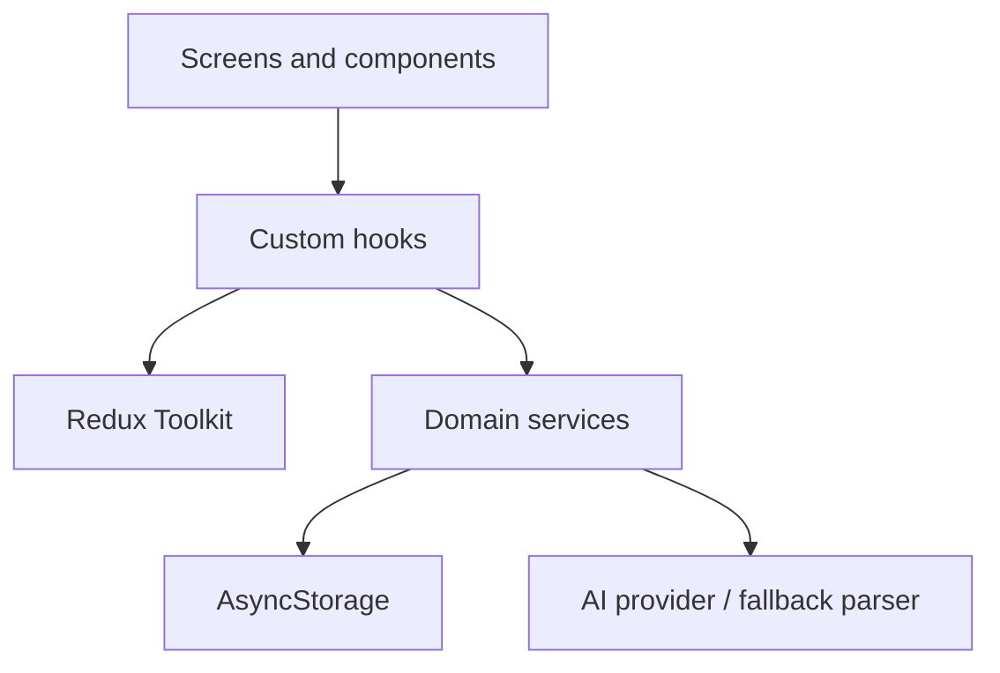
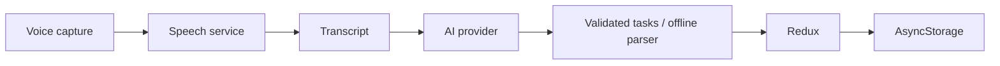

# Aair Tasks

A polished Expo/React Native task manager with strict TypeScript, Redux Toolkit, offline persistence, search, due dates, theme preferences, and provider-based voice/AI task capture.

## Preview

<!-- Replace placeholders with real device captures before submission. -->


## Features

### Core

- Create, edit, complete, delete, and persist tasks with AsyncStorage.
- Validated title/description fields, empty/loading/error states, due dates, and accessibility labels.

### Bonus

- Live case-insensitive search, immutable sorting, dark/system theme preference, haptic feedback, voice/AI provider boundary, and deterministic offline parser fallback.

### Engineering

- Strict TypeScript, typed React Navigation, Redux Toolkit, service boundaries, memoized task rows, unit tests, and interview documentation.

## Technology stack

| Layer      | Technology                               |
| ---------- | ---------------------------------------- |
| Framework  | Expo + React Native                      |
| Language   | TypeScript strict mode                   |
| State      | Redux Toolkit                            |
| Navigation | React Navigation native stack            |
| Storage    | AsyncStorage behind `storage.service.ts` |
| Forms      | React Hook Form + Zod                    |
| Voice      | Speech service adapter                   |
| AI         | `AIProvider` / `OpenAIProvider`          |
| Icons      | Expo vector icons                        |

## Architecture



The flow is UI → hooks → store/services → storage/API. Screens compose layouts and navigation; they do not call AsyncStorage or provider SDKs directly.

## Folder structure

```text
src/
  components/common/   Reusable buttons, fields, empty state, FAB
  components/task/     Task-specific card presentation
  config/               Centralized environment configuration
  constants/            Colors, spacing, routes, storage keys
  hooks/                Reusable UI orchestration
  navigation/           Typed root stack and navigator
  screens/              Layout, navigation, and hook composition
  services/             Persistence, speech, and AI boundaries
  store/                RTK slices, store, and typed hooks
  theme/                Theme and typography tokens
  types/                Domain contracts
  utils/                Pure date and parser utilities
```

## Voice flow



The current Expo Go build exposes a typed speech boundary and a recoverable message because native speech recognition requires a development build/provider. Typed phrases still exercise the complete AI/fallback flow.

## Installation

```bash
npm install
npm start
```

Use `npm run android`, `npm run ios`, or `npm run web` for a target. For native speech recognition, create an Expo development build and connect a recognition provider inside `speech.service.ts`.

## Environment variables

Copy `.env.example` to `.env` when configuring a development build. Do not ship an OpenAI key in a client app; production should call a controlled backend proxy.

| Variable         | Purpose                                |
| ---------------- | -------------------------------------- |
| `OPENAI_API_KEY` | Placeholder for local development only |
| `OPENAI_MODEL`   | Model name, defaults to `gpt-4o-mini`  |

## Scripts

| Command             | Purpose                      |
| ------------------- | ---------------------------- |
| `npm start`         | Start Expo                   |
| `npm run typecheck` | Run strict TypeScript checks |
| `npm run lint`      | Run ESLint                   |
| `npm test`          | Run unit tests               |
| `npm run format`    | Format source                |

## Screenshot checklist

Required states are represented by placeholders in `screenshots/`: empty state, tasks, add/edit form, voice, dark theme, search, due date, and demo GIF. Physical screenshots and recordings must be captured on a device/simulator.

## Testing

The initial unit suite covers parser splitting/validation and reducer transitions. Run `npm test`. Recommended next coverage includes storage failure behavior, provider contract tests, navigation flows, and device accessibility checks.

## Accessibility and performance

Interactive controls expose roles and labels, touch targets are at least 44dp, task completion announces through semantic controls, and voice status uses a live region. FlatList virtualizes rows, TaskCard is memoized, search/sort are derived without mutation, and colors/spacing come from tokens.

## Error handling and limitations

Malformed storage safely resolves to an empty list. AI output is validated and falls back to a deterministic parser. Voice recognition requires a development build; there is no cloud sync, authentication, notifications, or backend proxy yet. These are documented future seams rather than hidden assumptions.

## Design decisions

See [Choice.md](./Choice.md) for the full interview playbook, trade-offs, future improvements, and 50 interview questions with suggested answers.

## Submission checklist

- [ ] Replace screenshot/demo placeholders with real captures.
- [ ] `npm test`, `npm run typecheck`, and `npm run lint` pass.
- [ ] `.env.example` remains secret-free.
- [ ] Choice.md and README reflect the shipped behavior.

Created for the AAIR Labs Developer Exercise.
